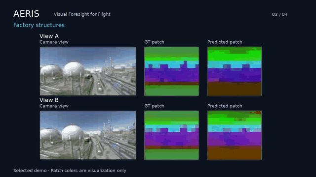
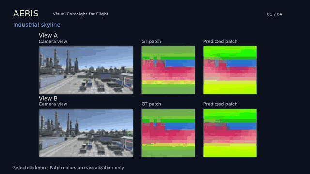
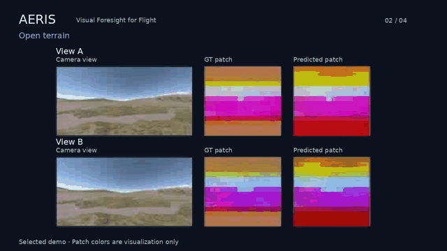
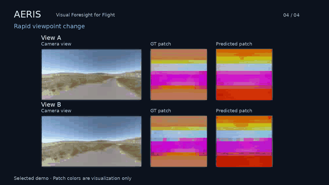

# AERIS

### Visual Foresight for Flight

**See beyond the next move.**

AERIS looks ahead from a drone’s point of view. Watch how its predictions compare with what the drone sees as it moves through the scene.

[Watch the featured demo](media/03_tanks.mp4) · [Explore all four scenes](#explore-the-scenes)

## Looking ahead in flight

When a drone turns, an opening can come into view while a nearby obstacle slips out of sight. At speed, there is little time to respond. Being able to anticipate these changes could give a drone more time to choose its next move.

That is the idea behind AERIS. The demos below follow different movements from the same starting point, showing how the view changes in each case and how well the predictions follow those changes. You can see the comparison across open ground, industrial structures, and sharper turns.

## Reading the demos

**Camera view** shows the scene as the drone sees it. **GT patch** is the reference visual map, and **Predicted patch** is the model’s forecast. The colors make the maps easier to compare; they are not generated camera images.

## Explore the scenes

| Industrial skyline | Open terrain |
| :---: | :---: |
|  |  |
| [Watch MP4](media/01_factory.mp4) | [Watch MP4](media/02_ridge.mp4) |

| Factory structures | Rapid viewpoint change |
| :---: | :---: |
|  |  |
| [Watch MP4](media/03_tanks.mp4) | [Watch MP4](media/04_turn.mp4) |

Selected, trimmed visual examples from simulation. These clips do not show autonomous flight.

---

© AERIS. Demo media and page text are shared for viewing; all rights reserved.
